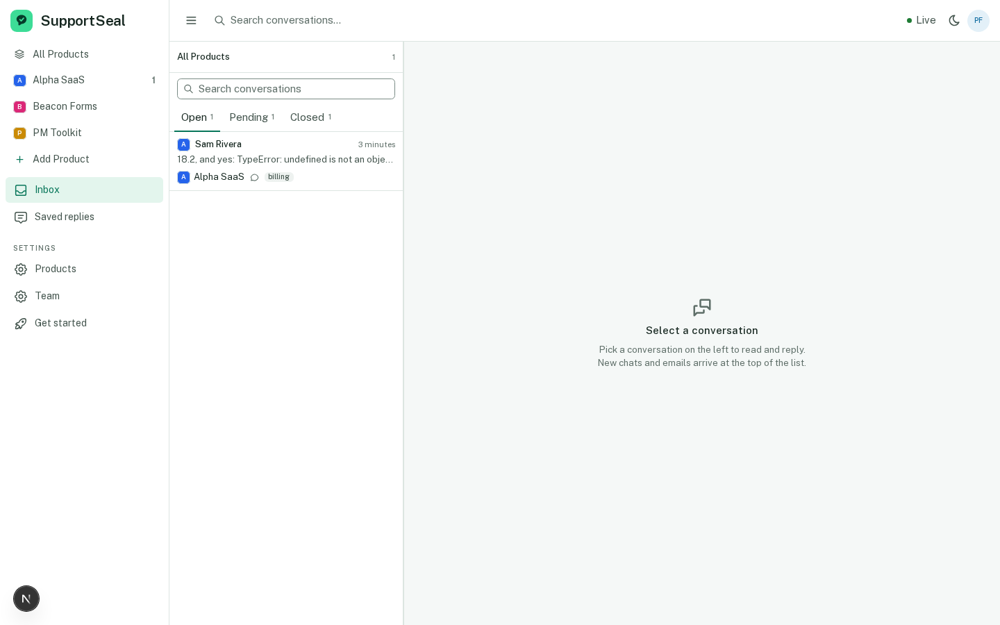
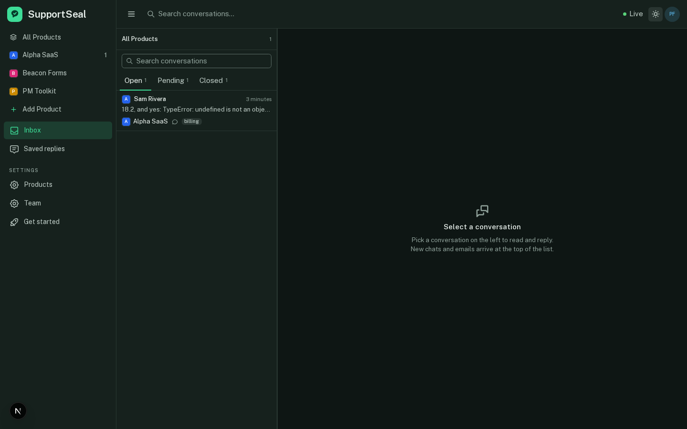
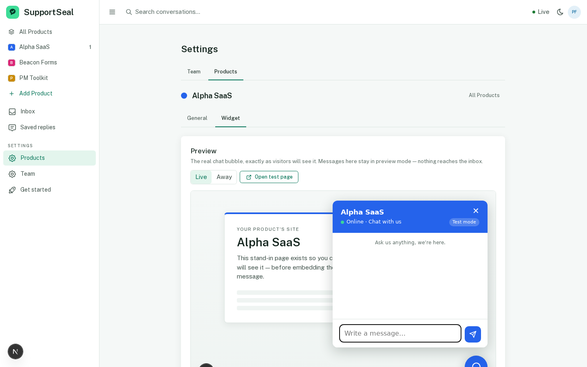

# SupportSeal

Open-source customer support platform for people building several independent
products: one unified inbox, a chat widget, and first-class support email per
Product — with genuine self-hosting from the same source as the managed
hosted tier. **Early build.** The product promise lives in
[docs/PRD.md](docs/PRD.md).

| Inbox · light | Inbox · dark | Chat widget |
| --- | --- | --- |
|  |  |  |

## Quickstart

Requires Node.js 22–24 (see `.nvmrc`) and npm.

```bash
git clone https://github.com/Supportseal/SupportSeal-app.git
cd SupportSeal-app
cp .env.example .env
npm install        # also runs prisma generate
npm run db:dev     # migrate the local PGlite database (.dev-data/)
npm run dev        # http://localhost:3000 — no DATABASE_URL needed
```

With a real Postgres instead: set `DATABASE_URL` and run `npm run db:migrate`.

## Self-hosting

`docker compose up` runs Postgres, applies migrations, and serves the app on
http://localhost:3000 (health: `/api/health`). The full guide — environment
reference, email setup, HTTPS proxy, backups, upgrades — is
[docs/self-hosting.md](docs/self-hosting.md). Widget installation:
[docs/widget-integration.md](docs/widget-integration.md). API:
[docs/api-quickstart.md](docs/api-quickstart.md), API tokens:
[docs/api-tokens.md](docs/api-tokens.md), and the live OpenAPI spec at
`GET /api/openapi.json`.

## Development

| Command | Meaning |
| --- | --- |
| `npm run verify:fast` | lint + typecheck + tests |
| `npm run verify` | verify:fast + build |
| `npm run verify:full` | verify + hosted and self-hosted Playwright E2E |

E2E installs Chromium with `npx playwright install chromium` and boots its
own dev servers and throwaway databases.

## Docs

[PRD](docs/PRD.md) and [FRD](docs/FRD.md) are the **canonical** product
requirements. [docs/open-questions.md](docs/open-questions.md) records
decisions taken and maintainer-overridable defaults;
[docs/architecture.md](docs/architecture.md) covers technical direction and
[docs/adr/](docs/adr) the accepted decisions. [AGENTS.md](AGENTS.md)
summarises architecture, safety constraints and the verification rules for
coding agents and contributors.

## Contributing

Open an issue for bugs or proposed changes; submit pull requests against
`main`. Run `npm run verify` before submitting, and verify important
user-facing flows in the browser (see [AGENTS.md](AGENTS.md)).

## Licence

AGPLv3 — see [LICENSE](LICENSE).
